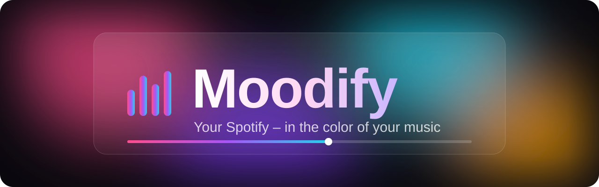
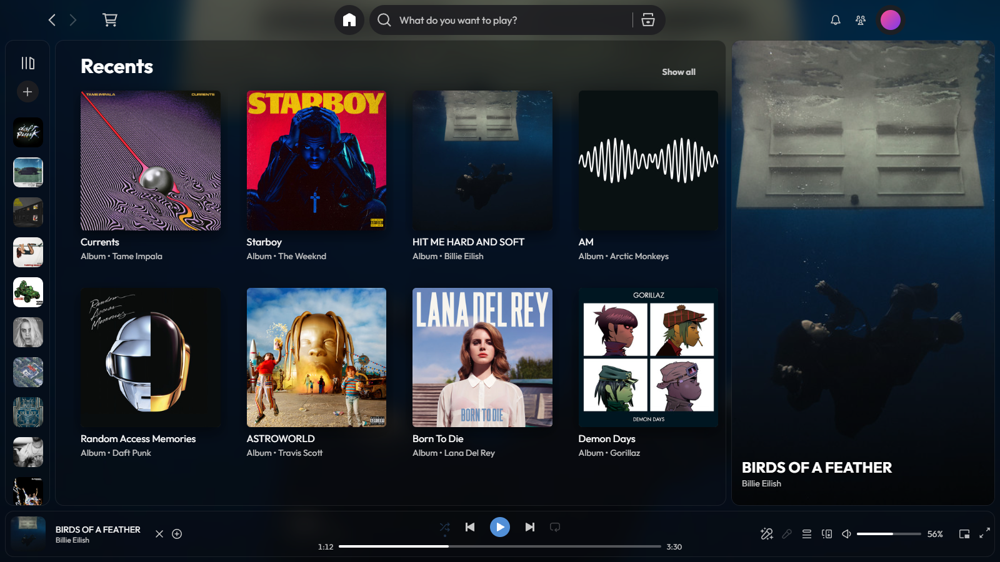
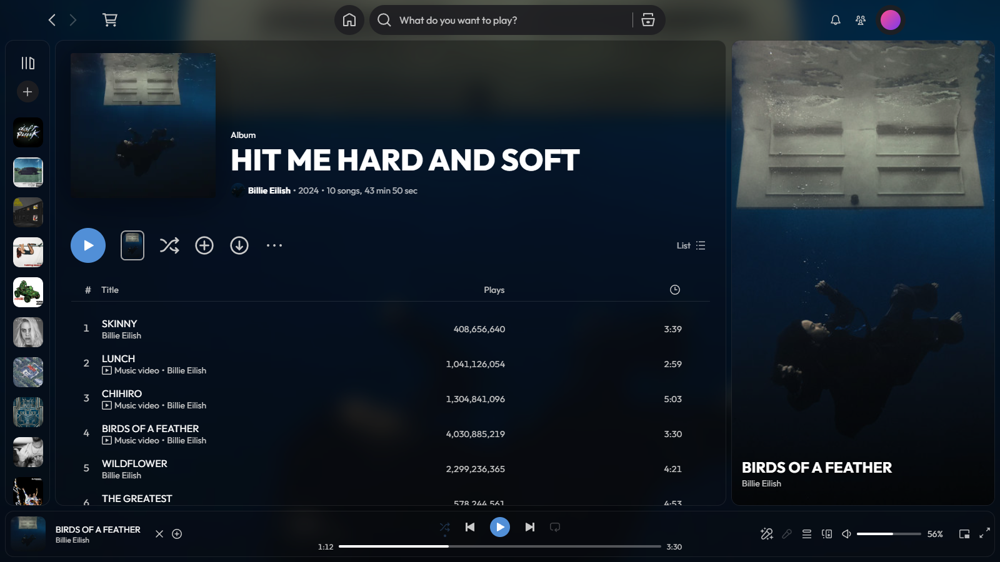

<p align="center">
  
</p>

<p align="center">
  <a href="https://github.com/Juxnji/moodify/releases/latest"></a>
  
  
  
  <a href="LICENSE"></a>
</p>

<p align="center">
  <b>A Spotify theme that adapts to every song.</b><br>
  Blurred album cover background, frosted glass panels and colors taken straight from the cover –<br>
  installed with a single line.
</p>

<p align="center">
  <a href="#-installation">Installation</a> ·
  <a href="#-features">Features</a> ·
  <a href="#%EF%B8%8F-versions">Versions</a> ·
  <a href="#-troubleshooting">Help</a>
</p>

---

## 📸 Preview

<p align="center">
  
</p>
<p align="center">
  
</p>
<p align="center"><sub>Background, buttons and glow automatically take on the colors of the cover that's playing.</sub></p>

---

## ✨ Features

| | |
|---|---|
| 🖼️ **Album background** | The cover of the current song, softly blurred – cross-fades on every song change |
| 🎨 **Colors from the cover** | Play button, progress bar and glow effects automatically match the cover |
| 🧊 **Frosted glass** | Translucent panels with rounded corners and the modern *Outfit* font |
| ✨ **Glow** | Buttons glow on hover, the sidebar lights up in the album color |
| 🏠 **Clean home page** | Only "Recents" (or "Jump back in") as a fixed 2 × 4 grid – hide single tiles with **×** |
| 🎬 **Now playing sidebar** | The cover or song video fills the whole sidebar with the title on top – fixed, no scrolling |
| 🛒 **Marketplace included** | Patched for new Spotify versions: the *Themes · Snippets · Apps* tabs are back |
| 🎤 **Extras** | [Spicy Lyrics](https://github.com/Spikerko/spicy-lyrics) (karaoke-style lyrics), volume in %, "Play next" |
| 🔢 **Right version, automatically** | The installer detects your Spotify version and picks the Moodify version that matches |

---

## 🚀 Installation

**1. Install Spotify**

From [spotify.com/download](https://www.spotify.com/download) – **not** from the Microsoft Store. Open it once and log in.

**2. Open PowerShell**

Press <kbd>Windows</kbd> → type `PowerShell` → <kbd>Enter</kbd> (**not** "Run as administrator").

**3. Paste this line and press <kbd>Enter</kbd>**

```powershell
iwr -useb https://raw.githubusercontent.com/Juxnji/moodify/main/install.ps1 | iex
```

Done – Spotify restarts and looks like Moodify. 🎉

> [!TIP]
> **You don't need to install Spicetify yourself.** If it's missing, the installer sets it up automatically –
> in the version Moodify was tested with, without asking any questions.

<details>
<summary><b>What exactly does it do?</b></summary>
<br>

1. Checks that Spotify is installed and reads its version
2. Looks up the Moodify version tested with that Spotify version in [`versions.json`](versions.json)
3. Installs [Spicetify](https://spicetify.app) if it's missing, or updates it if it's too old
4. Downloads Moodify and the patched Marketplace
5. Downloads the extensions directly from their authors
6. Configures Spicetify and applies everything to Spotify

You can read the whole script [here](install.ps1).

</details>

<details>
<summary><b>Prefer to install Spicetify yourself first?</b></summary>
<br>

Totally optional – the line above does this for you. If you want to do it by hand anyway,
run the official Spicetify installer in PowerShell (**not** as administrator):

```powershell
iwr -useb https://raw.githubusercontent.com/spicetify/cli/main/install.ps1 | iex
```

- When it asks *"Do you also want to install Spicetify Marketplace?"* you can press **N** – Moodify brings a patched Marketplace.
- Afterwards run the Moodify line from step 3. It detects the existing Spicetify and uses it.

More about Spicetify: [spicetify.app/docs/getting-started](https://spicetify.app/docs/getting-started)

</details>

---

## 🔄 Updates

After a **Spotify update** the theme is sometimes gone – that's normal with Spicetify.
Just **run the same line again**:

```powershell
iwr -useb https://raw.githubusercontent.com/Juxnji/moodify/main/install.ps1 | iex
```

It automatically gets the newest Moodify version that matches your Spotify.

---

## 🗂️ Versions

| Moodify | Tested with Spotify | Spicetify | Date |
|:---:|:---:|:---:|:---:|
| [**v1.0.1**](https://github.com/Juxnji/moodify/releases/tag/v1.0.1) | 1.3.4 | 2.45.3 | 2026-10-10 |
| [v1.0.0](https://github.com/Juxnji/moodify/releases/tag/v1.0.0) | 1.3.4 | 2.45.3 | 2026-10-10 |

What changed in each version: [**Changelog**](CHANGELOG.md)

<details>
<summary><b>Install a specific version</b></summary>
<br>

Usually not needed – the installer picks the right one. If you want to anyway:

```powershell
$env:MOODIFY_VERSION = "v1.0.1"; iwr -useb https://raw.githubusercontent.com/Juxnji/moodify/main/install.ps1 | iex
```

</details>

---

## ❓ Troubleshooting

<details>
<summary><b>After a Spotify update everything looks normal again</b></summary>
<br>

Spotify overwrites its files when it updates. Run the [install line](#-installation) again.
If the installer says "not tested with Spotify X yet", there may be small visual glitches until a Moodify update is out.

</details>

<details>
<summary><b>"Spotify was not found"</b></summary>
<br>

You probably have the Microsoft Store version, which doesn't work with Spicetify.
Uninstall it and install Spotify from [spotify.com/download](https://www.spotify.com/download).

</details>

<details>
<summary><b>Spicy Lyrics says "Waiting for Spicetify"</b></summary>
<br>

This can happen on the very first start after installing, while Spicetify is still getting ready.
Click **"Reload Spotify"** in that message – after that it works normally.

</details>

<details>
<summary><b>"PowerShell is running as administrator"</b></summary>
<br>

Spicetify must not run with administrator rights. Close the window, open PowerShell again **normally**
(<kbd>Windows</kbd> → `PowerShell` → <kbd>Enter</kbd>, not "Run as administrator") and paste the line again.

</details>

<details>
<summary><b>Spicetify shows an error while applying</b></summary>
<br>

Open PowerShell **without** administrator rights, close Spotify completely (also in the tray next to the clock) and run the line again.
Still not working? [Report a problem](https://github.com/Juxnji/moodify/issues/new/choose) – with a screenshot of the message.

</details>

<details>
<summary><b>Is this allowed?</b></summary>
<br>

Spicetify modifies the Spotify app on your PC. That isn't covered by Spotify's terms of use,
but in practice Spotify hardly acts against it. Use at your own risk.

</details>

---

## 🗑️ Uninstall

```powershell
iwr -useb https://raw.githubusercontent.com/Juxnji/moodify/main/uninstall.ps1 | iex
```

Spotify goes back to looking completely normal.

---

## 🙏 Credits

- [**Spicetify**](https://spicetify.app) – makes all of this possible
- [**Marketplace**](https://github.com/spicetify/marketplace) – the shopping cart (patched here for Spotify 1.3.3+)
- [**Spicy Lyrics**](https://github.com/Spikerko/spicy-lyrics) by Spikerko
- [**Volume Percentage** & **Play Next**](https://github.com/daksh2k/Spicetify-stuff) by daksh2k
- Font [**Outfit**](https://fonts.google.com/specimen/Outfit) from Google Fonts

## 📄 License

Moodify is released under the [MIT License](LICENSE). Bundled and installed parts keep their own licenses.
